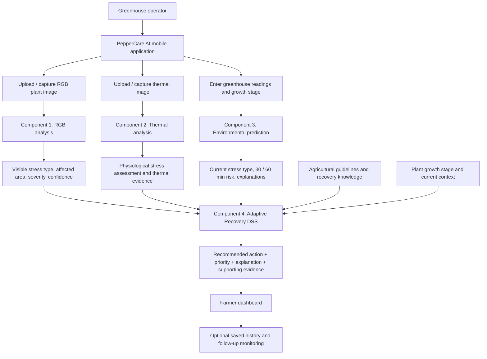
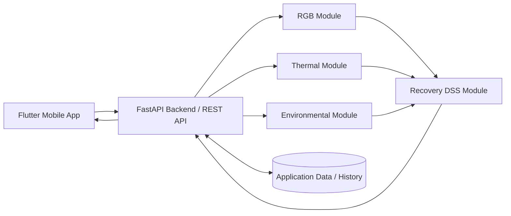

#  PepperCare AI

### A multimodal AI framework for understanding bell pepper plant stress — and deciding what to do next

**Research title:** *Development of a Multimodal AI Framework for Early Bell Pepper Stress Detection and Adaptive Recovery in Greenhouse Environments*  
**Research group:** `J26_IT_351`  
**Crop:** Bell pepper (*Capsicum annuum*)  
**Application:** Greenhouse plant-stress assessment and recovery decision support  
**Research approach:** Four independently evaluated components integrated into one farmer-facing system

> **In one sentence:** PepperCare AI combines **what a plant looks like (RGB)**, **how its temperature behaves (thermal)**, and **what its greenhouse environment may cause next (environmental prediction)** to help a farmer understand stress and receive **an explainable recovery recommendation (DSS)**.

---

##  The entire research, at a glance

| The question a farmer asks | What PepperCare AI uses | Research component | What the farmer receives |
|---|---|---|---|
| **“What is visibly wrong with this plant?”** | A normal phone/RGB image | **1 · RGB Stress Detection** | Stress class, visibly affected area, severity and confidence |
| **“Is the plant showing physiological stress, even if it looks normal?”** | A thermal image | **2 · Thermal Stress Detection** | Temperature-pattern evidence and physiological stress assessment |
| **“Could greenhouse conditions cause stress soon?”** | Environmental readings, time and growth stage | **3 · Environmental Stress Prediction** | Current stress assessment, 30-/60-minute risk and contributing factors |
| **“What should I do about it?”** | Outputs from Components 1–3 + crop knowledge | **4 · Adaptive Recovery DSS** | Prioritized, growth-stage-aware recovery guidance with reasons and evidence |

### The key difference

A conventional monitoring tool might say **“Temperature is high”** or **“Water stress detected.”** PepperCare AI is designed to connect the dots:

**Detect what is visible → assess physiological evidence → anticipate environmental risk → recommend and explain a response.**

The system is **decision support**, not an autonomous greenhouse controller or a guarantee of diagnosis. It is designed to help users make more informed decisions, with agronomic validation required before real-world reliance.

---

##  Why this research matters

Bell pepper plants can be affected by **water deficit, nutrient deficiency, insect pests, temperature stress and other unsuitable greenhouse conditions**. Different stresses can produce similar symptoms, while early physiological changes may occur before obvious visual damage.

In practice, farmers may have to interpret plant appearance, temperature conditions and separate readings themselves. That creates three related challenges:

1. **Late or incomplete detection:** visual changes may be subtle or ambiguous.
2. **Reactive management:** current readings do not necessarily reveal what may happen in 30–60 minutes.
3. **The action gap:** detecting a problem does not automatically tell a farmer which response is appropriate for the plant's growth stage and stress severity.

PepperCare AI investigates an integrated approach to these challenges rather than treating classification, prediction and recovery as unrelated tasks.

##  How all four components work together



**Important architecture distinction:** The first three components generate **different kinds of evidence**. Component 4 combines the available evidence for recovery decision support. This does **not** imply that an unverified end-to-end multimodal neural network has already been trained.

##  A real-world user journey

Imagine a greenhouse operator noticing a bell pepper plant that looks slightly wilted.

**Step 1 — Check the visible symptoms.** The operator takes an ordinary RGB photo. Component 1 examines the image and may return a result such as **Water Deficit · Moderate · 24.5% visibly affected area · 91% model confidence**.

**Step 2 — Check physiological evidence.** The operator also provides a thermal image. Component 2 measures relevant leaf-temperature patterns and may report **moderate physiological stress**, even when some symptoms are difficult to distinguish visually.

**Step 3 — Look ahead.** The operator enters current environmental readings. Component 3 estimates the likely environmental stress condition and may report **high heat-related stress risk within 60 minutes**, together with the factors influencing that prediction.

**Step 4 — Get a reasoned recovery plan.** Component 4 considers the three results, their limitations, plant growth stage and agricultural guidance. It may recommend **checking root-zone water availability and reviewing irrigation/ventilation conditions**, with an appropriate priority and an explanation of which evidence supports the suggestion.

**Step 5 — Check improvement.** A later scan may be compared with the earlier record to support follow-up monitoring: **improving, stable, worsening or recovered**, subject to suitable validation.

> **Illustrative scenario only:** The stress labels, percentages, confidence and future-risk values above explain the intended workflow. They are **not reported model results**, verified diagnoses, or validated agricultural prescriptions.

---

##  The four research components

### 01 · AI-Based RGB Bell Pepper Plant Stress Detection

**Core question:** *What visible stress is present, and how much of the visible leaf area is affected?*

**Inputs**
- RGB image captured using a phone or ordinary camera.
- Image-quality information, such as blur, lighting or plant visibility.

**Proposed processing**
1. Check image quality and preprocess the image.
2. Classify the selected visible stress condition with a deep-learning model.
3. Segment the visibly affected leaf region.
4. Estimate affected-area percentage and stress severity.
5. Generate a confidence score and a structured result.

**Target classes:** `Healthy`, `Water Deficit`, `Nutrient Deficiency`, `Aphid`, `Thrips`.

**Outputs:** Stress type, affected-region visualization, affected-area %, severity (`Mild / Moderate / Severe` where applicable), and confidence.

**Research contribution:** Integrates **classification + affected-region localization + quantitative severity assessment** in a bell pepper-focused RGB workflow rather than stopping at a class label.

**Important limitation:** RGB analysis relies on visible signs. Similar-looking symptoms can have different causes; an image-only result is not definitive physiological or agronomic diagnosis. Proposed severity cutoffs require dataset-based and expert validation.

---

### 02 · AI-Based Thermal Bell Pepper Plant Stress Detection

**Core question:** *Does the plant's temperature pattern indicate physiological stress?*

**Inputs**
- Thermal images of bell pepper leaves or plants.
- Associated temperature information and relevant measurement context, where available.

**Proposed processing**
1. Quality-check the thermal image.
2. Apply noise filtering, resizing/normalization and suitable thermal calibration.
3. Extract thermal characteristics such as **mean, minimum and maximum leaf temperature; temperature range; distribution; and gradients**.
4. Use an appropriate CNN/transfer-learning or feature-based machine-learning approach.
5. Classify/assess physiological stress and estimate stress status or level.

**Outputs:** Physiological stress assessment, stress level/status, confidence, thermal metrics and supporting evidence.

**Research contribution:** Adds **physiological temperature-based evidence** that may reveal stress responses before strong RGB symptoms are visible, supporting multimodal assessment.

**Important limitation:** An abnormal leaf temperature alone does not establish a unique stress cause. Interpretation depends on environmental context, thermal measurement quality and reference conditions.

---

### 03 · AI-Based Environmental Stress Prediction

**Core question:** *Are current greenhouse conditions stressful, and could risk increase soon?*

**Inputs**
- Air temperature
- Relative humidity
- Light intensity
- Soil/root-zone temperature
- Date and time
- Bell pepper growth stage, where available

**Proposed processing**
1. Validate and preprocess environmental readings.
2. Assess current conditions against a research-grounded environmental context.
3. Classify the likely environmental stress type.
4. Predict stress risk at **30-minute and 60-minute** horizons.
5. Identify influential factors and explain each prediction.

**Outputs:** Current-condition assessment, predicted environmental stress type, `30-min` and `60-min` risk scores/levels, contributing factors and an explanation.

**Research contribution:** Moves beyond **threshold-only monitoring** toward **short-horizon plant-stress risk prediction** with explainable contributing factors.

**Important limitation:** A forecast is a probabilistic **risk estimate**, not proof the plant will experience that stress. Suitable time-series data, sound labels and time-aware validation are essential.

---

### 04 · Adaptive Recovery Decision Support System (DSS)

**Core question:** *Given the available evidence, what is the most appropriate next action and why?*

**Inputs**
- RGB stress result and severity from Component 1.
- Thermal physiological-stress evidence from Component 2.
- Current/future environmental stress risk from Component 3.
- Plant growth stage and current conditions.
- Curated agricultural references, recovery guidance and relevant historical cases.

**Proposed processing**
1. Receive and standardize results from Components 1–3.
2. Compare and interpret the available evidence, including potentially conflicting results.
3. Consider severity, urgency, growth stage and environmental context.
4. Match the situation to justified recovery knowledge/rules.
5. Select and prioritize suitable actions.
6. Explain the recommendation and identify supporting evidence.

**Outputs:** Recommended recovery action, overall severity, priority (`Low / Medium / High`), explanation and supporting evidence.

**Research contribution:** Closes the gap between **stress identification** and **actionable, stage-aware, severity-aware, explainable recovery guidance**.

**Important limitation:** Recommendations must be checked against trustworthy crop guidance and, where possible, agricultural expert decisions. The DSS supports a farmer; it does not automatically operate irrigation, ventilation or fertilizer equipment.

---

##  What is novel about the combined research?

| Layer | Individual research contribution | Value to the overall system |
|---|---|---|
| **Visible evidence** | RGB classification with affected-area localization and severity | Helps answer **what** is visibly wrong and **how extensive** it is |
| **Physiological evidence** | Thermal stress assessment from leaf-temperature patterns | Adds a different view of plant condition, including potentially early signs |
| **Forward-looking evidence** | Explainable 30-/60-minute environmental stress-risk prediction | Helps move from **reacting** to **anticipating** |
| **Actionable intelligence** | Stage-aware and severity-aware recovery DSS | Explains **what action to consider next and why** |
| **Whole framework** | Integrates the four complementary components | Provides one coherent farmer-facing workflow instead of isolated outputs |

These are the **proposed research contributions**. Their novelty and effectiveness must be substantiated through literature comparison and experimental evaluation; this README does not claim that no similar systems exist.

##  What the farmer sees in the app

The **PepperCare AI** mobile experience is intended to make the research understandable without requiring the user to know how each AI model works.

| Screen / feature | Farmer-facing purpose |
|---|---|
| **Onboarding & Sign In / Registration** | Enter the application and manage access |
| **Home** | Navigate between the four research modules |
| **RGB Stress Detection** | Upload/capture a plant image and inspect visible stress findings |
| **Thermal Stress Detection** | Submit a thermal image and inspect physiological stress evidence |
| **Environmental Stress Prediction** | Enter readings; view current assessment and future risk |
| **Adaptive Recovery Plan** | View recommended action, priority, explanation and evidence |
| **Insights** | View a consolidated summary of important findings |
| **Data / History** | Find previously saved analyses and monitoring records |
| **Settings** | Manage account and notification preferences |
| **Follow-up Tracking** | Compare plant scans over time, where implemented |

**User interaction is deliberately simple:** provide the required inputs, inspect the results, and decide whether to follow the proposed action. The framework is **not dependent on an IoT installation**; environmental readings can be entered manually and public datasets can support research development.

---

##  Proposed application architecture

The recommended prototype architecture is a **modular monolith**: **one Flutter mobile app**, **one FastAPI backend**, and **four clearly separated research modules**. This is easier to integrate and evaluate during a final-year research project while preserving the option to split modules into microservices later.



**Technology direction (proposed, subject to implementation choices):**

| Layer | Candidate technology / role |
|---|---|
| Mobile frontend | **Flutter / Dart** |
| Backend and integration | **Python / FastAPI** |
| RGB AI | **PyTorch or TensorFlow**, e.g. MobileNetV2 / EfficientNet-family classification and U-Net-style segmentation |
| Thermal AI | Thermal preprocessing plus CNN/transfer-learning or feature-based ML |
| Environmental AI | **Scikit-learn / XGBoost** or suitable time-series approaches; model explanations where appropriate |
| Recovery DSS | Curated agricultural knowledge + decision/reasoning engine |
| Data storage | **Firebase Firestore** or another validated application datastore |
| Development & collaboration | **Git / GitHub**, notebook/GPU environment where necessary |

> Technologies listed here describe the **intended design**, not a verified inventory of installed dependencies or completed deployments.

### Suggested modular structure

```text
peppercare-ai/
├── mobile_app/                  # Flutter app
│   └── lib/
│       ├── screens/             # Home, RGB, Thermal, Environment, DSS, History
│       ├── features/            # Feature-specific state and UI logic
│       └── services/            # Backend/API integration
├── backend/                     # Single FastAPI deployment
│   ├── main.py
│   ├── modules/
│   │   ├── rgb/
│   │   ├── thermal/
│   │   ├── environmental/
│   │   └── recovery_dss/
│   ├── schemas/                 # Shared request/response contracts
│   └── storage/                 # Result/history persistence
├── research/                    # Experiments, evaluation, documentation
├── docs/                        # Architecture, references, research evidence
└── README.md
```

*This is a suggested repository organization—not a claim about the current repository contents.*

### How components exchange results

Each component should produce a **clear structured result**, with fields that the DSS can interpret consistently. A shared contract prevents one model's label or severity convention from being misinterpreted by another module.

```json
{
  "plant_id": "BP-025",
  "assessment_id": "demo-assessment-001",
  "rgb": {
    "stress_type": "Water Deficit",
    "severity": "Moderate",
    "affected_area_percent": 24.5,
    "confidence": 0.91
  },
  "thermal": {
    "physiological_stress": "Moderate",
    "confidence": 0.88
  },
  "environmental": {
    "current_stress_type": "Heat-related risk",
    "risk_30_min": "Moderate",
    "risk_60_min": "High",
    "contributing_factors": ["Air temperature", "Relative humidity"]
  },
  "recovery": {
    "priority": "High",
    "recommended_action": "Inspect root-zone water availability and review irrigation conditions",
    "explanation": "Visual water-deficit signs and thermal stress evidence align with elevated near-future environmental risk.",
    "requires_farmer_review": true
  }
}
```

*Illustrative JSON contract, not a confirmed live endpoint or observed output.* Each result should also carry suitable timestamps, model versions and input-source metadata when deployed.

---

##  How the research will be evaluated

The project is not complete merely because screens display predictions. Each component requires its own scientific validation, followed by system-level evaluation.

| Research area | Evaluation focus |
|---|---|
| **RGB classification** | Accuracy, precision, recall, F1-score and confusion matrix; testing on unseen plants/images |
| **RGB segmentation** | Intersection over Union (IoU), Dice score and quality of affected-area estimates |
| **RGB severity** | Agreement of predicted severity/affected area with independently labeled reference data |
| **Thermal stress** | Relevant classification/regression metrics, robustness and agreement with trustworthy physiological references |
| **Environmental prediction** | Class/risk metrics, time-aware validation and horizon-specific performance for 30 and 60 minutes |
| **Recovery DSS** | Agreement with agricultural experts/guidelines, action appropriateness and explanation quality |
| **Integrated application** | API/data consistency, usability, response times and end-to-end test scenarios |

### Data and responsible-AI principles

- Use **licensed, traceable public data**, with permissions for any greenhouse-collected samples.
- Check labels, duplicates, image quality, missing values and class imbalance.
- Avoid data leakage through careful image-source/plant grouping and time-aware environmental splits.
- Evaluate on **unseen data**; never present training examples as independent test evidence.
- Report uncertainty, model limitations and disagreement between components.
- Keep agricultural recommendations explainable and based on reviewed sources.
- Apply appropriate access control if accounts, plant records or analysis history are stored.

**No performance numbers are claimed in this README** until they are supported by reproducible experiments.

##  Research ownership

| Member | Student ID | Research responsibility |
|---|---|---|
| **Mendis A.G.P.H.** | `IT22552174` | Component 1 — RGB visible-stress detection, segmentation and severity |
| **Gunasena G.K.D.S.** | `IT23233812` | Component 2 — Thermal physiological-stress detection |
| **Samarasinghe M.H.C.T.** | `IT23310728` | Component 3 — Environmental stress prediction |
| **Kaluarachchi E.I.** | `IT23357426` | Component 4 — Adaptive recovery decision support |

All four components contribute to the **same integrated research framework**. Independent model evaluation and combined end-to-end testing are both necessary.

##  Research-to-prototype roadmap

- [ ] Consolidate research papers, agronomic references and verified datasets.
- [ ] Finalize class definitions, stress/temperature reference criteria and evaluation protocols.
- [ ] Train and validate each component independently.
- [ ] Agree on shared data schemas, missing-data handling and confidence reporting.
- [ ] Integrate the components through the backend into the mobile application.
- [ ] Validate DSS decisions against relevant agricultural guidance and expert input.
- [ ] Demonstrate database persistence, end-to-end use cases and usability.
- [ ] Document experimental findings, remaining limitations and future work.

**Status note:** These are milestones, **not a claim that all items are outstanding**. Progress should be marked against actual code, models, datasets, evaluation reports and deployed services before publishing a definitive implementation status.

##  Frequently asked questions

**Is this four separate apps?**  
No. The research consists of four **separate technical contributions** designed to appear as **one coherent PepperCare AI application**.

**Why both RGB and thermal?**  
RGB captures **visible changes**; thermal imagery provides **temperature-based physiological evidence**. Neither is a complete substitute for the other.

**Does the environmental module control greenhouse equipment?**  
No. Its primary role is to **assess and predict stress risk**, including 30-/60-minute horizons. Automated actuation is outside the core proposed scope.

**Is an IoT sensor network mandatory?**  
No. The research can use public datasets, uploaded images and manually entered environmental readings. Sensors may support data collection where available, but an IoT deployment is **not required**.

**Does the DSS just show generic tips?**  
The research goal is **context-sensitive recovery support** based on multiple stress signals, severity, plant growth stage, current conditions and justified agricultural knowledge.

**Can a farmer trust every recommendation automatically?**  
No. Confidence, evidence and limitations should be communicated clearly. The farmer or an agricultural expert remains responsible for real-world intervention decisions.

---

##  The final vision

> **One plant. Multiple sources of evidence. One understandable decision-support experience.**
>
> **PepperCare AI aims to help greenhouse farmers see stress earlier, understand risk sooner, and choose a better-informed recovery response.**

*Research prototype · Bell pepper greenhouse cultivation · J26_IT_351*
